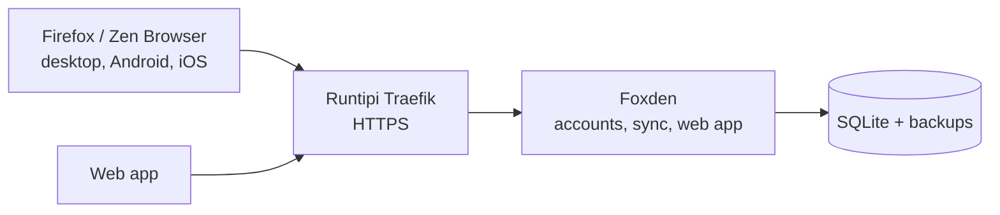

# Foxden

## Your own Firefox Sync server

Foxden is a self-hosted **Firefox Sync** server for a household or a small group. It replaces every
Mozilla service that Sync uses with **one Docker container and one SQLite database**. Stock
Firefox — and Zen Browser — work without add-ons and without custom builds.

Your bookmarks, history, passwords and tabs stay on a server you control, and nothing depends on
Mozilla's servers.

Foxden is an independent project and isn't affiliated with or endorsed by Mozilla. Firefox is a
trademark of the Mozilla Foundation.

## Features

- Works with **stock Firefox** on desktop, Android and iOS — and with **Zen Browser**, which uses
  the same Firefox Accounts and Sync machinery.
- **End-to-end encrypted.** Firefox encrypts your data before uploading it, so the server only
  stores ciphertext.
- **Invite-only accounts**, with user and admin roles.
- A **web app** to manage your profile, your signed-in devices, and (for admins) everyone's
  accounts.
- **One-time password reset links** for anyone who forgets their password.
- **Nightly database backups** (keep the last 7 by default).
- Optional **email** for invite links and password resets.

## Architecture

Foxden serves the web app and every endpoint Firefox Sync needs on a **single port (3000)**. It
keeps its database, backups and logs in `/data`.

## ⚠️ HTTPS is required

Firefox will not sign in to a plain-HTTP server, except on `localhost`. In Runtipi, the app is
served over HTTPS by the built-in Traefik reverse proxy — you just have to set the **public base
URL** field at install time to the domain Runtipi gave the app (for example
`https://foxden.tipi.lan`).

> **Firefox for Android and iOS sign in over HTTPS only.** Desktop Firefox can be pointed at a
> plain-HTTP loopback address with an extra preference, but mobile cannot — use the HTTPS route.

## Install

1. Install the app from this store.
2. Set **Public base URL of this instance** to the address the app is served at
   (`https://<your-runtipi-domain>`). No trailing slash.
3. Leave **Trusted proxy** empty unless the proxy in front of Foxden is not on a private network.
4. Open the app. The first account is created automatically:
   - email: `admin@example.com`
   - password: `changeme`
5. **Change that email and password immediately** — the app asks for it before anything else, and
   the default password is a known value.

## Connect Firefox (and Zen)

Do this once per device. In the web app, the **Getting started** page shows the exact values to
copy, including the URL. In short, on desktop:

1. In Firefox, open **Settings → Sync**. If you are signed in to a Mozilla account, choose
   **Sign out**.
2. Open `about:config` and accept the warning.
3. Set the preference **`identity.fxaccounts.autoconfig.uri`** to the address of this instance
   (the web app's Getting started page gives you the exact value to copy).
4. If the server is on plain HTTP over a loopback address, also set the Boolean
   **`identity.fxaccounts.allowHttp`** to `true`. This is not needed over HTTPS.
5. Restart the browser, then open **Settings → Sync → Sign in**. The sign-in page opens on this
   instance.

On **Android**, open **Settings → About Firefox** and tap the Firefox logo five times to unlock
the debug menu, then **Settings → Sync Debug → Custom Mozilla account server** and paste the
instance address. Leave *Custom Sync server* empty — Firefox finds it from the account server.

On **iOS**, open **Settings**, tap the version number five times, then **Advanced Sync Settings →
Use Custom FxA Content Server**.

### Zen Browser

Zen uses the same Firefox Accounts and Sync engine, so the same preference works:

1. Sign out of any Mozilla account in **Zen → Settings → Sync**.
2. Open `about:config` and set **`identity.fxaccounts.autoconfig.uri`** to the instance address.
3. Restart Zen, then sign in from **Settings → Sync**.

Zen's own "Spaces" (workspaces) are stored locally and are not part of Firefox Sync, so they stay
on the device. Bookmarks, history, passwords, tabs and extensions do sync.

## Configuration

| Variable | Default | Purpose |
|---|---|---|
| `WEB_APP_BASE_URL` | — | The public address browsers reach. Must match the Runtipi route. |
| `TRUST_PROXY` | `loopback,linklocal,uniquelocal` | Which proxies to believe when reading `X-Forwarded-For`. Runtipi's Traefik is on a private network, so the default already covers it. |
| `DATABASE_PATH` | `/data/foxden.sqlite` | SQLite database. |
| `BACKUP_PATH` | `/data/backups` | Where the nightly backups land. |
| `BACKUP_RETENTION` | `7` | How many backups to keep. |
| `TYPEORM_MIGRATIONS_RUN` | `true` | Applies pending schema migrations on start. |
| `EMAIL_SMTP_HOST` | — | Empty turns email off; invite links are then shown in the web app. |
| `EMAIL_SMTP_PORT` | `587` | `587` for STARTTLS, `465` for implicit TLS. |
| `EMAIL_SMTP_USERNAME` / `EMAIL_SMTP_PASSWORD` | — | Leave the username empty for a relay that takes mail without signing in. |
| `EMAIL_SMTP_SECURE` | `false` | Implicit TLS. Off for port 587. |
| `EMAIL_FROM_ADDRESS` | `foxden@localhost` | Sender address. |
| `LOG_STDOUT_LEVEL` | `info` | Log verbosity. |

## Backups

Foxden backs up its database every night to `/data/backups` and keeps the last seven copies. To
back up immediately, open **Background jobs → Back up database → Run Now**.

The backups live on the same volume as the database. **Copy them off the server** so they survive
a disk failure. They cannot decrypt synced data, but they do hold password hashes and keys that
can change live server data — protect them accordingly.

The nightly backup is *not* a substitute for backing up the whole app data directory: it covers the
SQLite database only.

## Notes and limits

- **linux/amd64 only.** The upstream image is published for `amd64` alone. It runs on an x86_64
  Runtipi host; on ARM it will not start.
- The project is young — keep your own backups.
- The proxy must accept request bodies of at least 3 MB (sync uploads can exceed 2.5 MB) and must
  keep the `Authorization` header out of its logs. Runtipi's Traefik default is fine.
- A failed nightly backup is logged as an error and turns the backup job off. Fix the problem, then
  turn the job back on in **Background jobs**.

## Links

- Repository: https://github.com/lcollins-dev/foxden
- Releases: https://github.com/lcollins-dev/foxden/releases
- Deployment guide: https://github.com/lcollins-dev/foxden/blob/master/DEPLOYMENT.md
